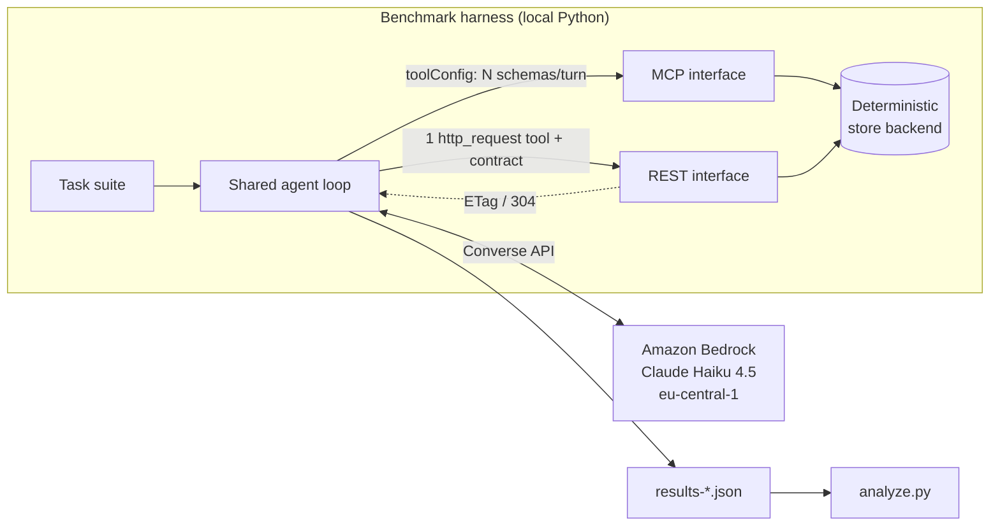

# mcp-vs-rest-bench

A measured head-to-head between a **stateless MCP server** and a **plain REST API**
serving the *same* backend to the *same* agent on the *same* tasks.

Companion to the blog post *"If MCP is stateless, is it just REST? I measured it"*
on [edoardodusi.com](https://edoardodusi.com).

The question comes from the 2026-07-28 MCP spec, which
[removed protocol-level sessions](https://modelcontextprotocol.io/specification/2026-07-28/changelog).
If a tool server is now just stateless HTTP, is MCP just REST with extra steps?
This harness answers it with data instead of taste.

## What it does

One deterministic backend (`backend.py`) is exposed through two interfaces over
the **same six operations**:

- `iface_mcp.py`: operations as native tool-use schemas on Amazon Bedrock's
  Converse API. This is what a stateless MCP server reduces to on the wire:
  tool names plus JSON schemas presented to the model every turn.
- `iface_rest.py`: a single `http_request` tool plus an OpenAPI-style contract
  in the system prompt (read once), with a real `ETag` / `304 Not Modified`
  cache so conditional reads can be measured.

The same agent loop (`runner.py`) runs both against the same task suite
(`tasks.py`) and records success, tokens, latency, round-trips, tool calls and
cache hits. `distractors.py` scales the API surface so you can see the MCP
per-turn schema tax grow while REST stays flat.

## Architecture



## Run it

```bash
# Prereqs: Python 3.11+, AWS credentials with Bedrock access, model enabled.
export AWS_PROFILE=your-sandbox-profile   # needs bedrock:InvokeModel
python3 -m venv .venv && . .venv/bin/activate
pip install boto3

# Small API surface (6 tools): MCP and REST tie.
python runner.py --trials 5 --catalog 0  --out results-small.json

# Large API surface (30 tools): MCP pays the per-turn schema tax.
python runner.py --trials 5 --catalog 24 --out results-large.json

# Aggregate into markdown tables.
python analyze.py results-small.json results-large.json
```

Flags: `--model` (default `eu.anthropic.claude-haiku-4-5-20251001-v1:0`),
`--region` (default `eu-central-1`), `--trials`, `--catalog`, `--out`.

### Scenario 2: where MCP wins (strict unfamiliar API)

Scenario 1 above is REST's turf (per-request efficiency). Scenario 2 is MCP's:
a strict analytics API with non-guessable enum values and formats. MCP gets its
normal typed tool schema (enums enumerated, host validates the call). REST gets
a realistic *terse* human contract that names the params but not every enum.

```bash
python strict_runner.py --trials 6 --out results-strict.json
```

`strict_backend.py` + `strict_scenario.py` + `strict_runner.py`.

## Headline results

See `RESULTS.md` for the full tables. In short, measured on Claude Haiku 4.5,
`eu-central-1`, 5 trials:

- **Small surface (6 tools):** tie. 100% success both, tokens within ~1%, same
  round-trips. REST's only edge is caching.
- **Large surface (30 tools):** same success and round-trips, but MCP spends
  **~35% more total tokens** and **~37% more input tokens**, because it re-sends
  every tool schema every turn. REST's one `http_request` tool stays flat.
- **Caching:** REST scores 5/5 conditional-read cache hits (`If-None-Match` ->
  `304`); MCP tool use has no standard conditional read, so 0/5.
- **Strict unfamiliar API (scenario 2):** both reach 100% final success, but MCP
  is correct on the **first** call 100% of the time vs **0%** for the terse-contract
  REST agent, which guesses an enum wrong, eats a `400`, and self-corrects. MCP
  uses half the tool calls, ~65% fewer tokens and ~75% lower latency. Typed,
  validated discovery is MCP's structural win. (You *can* close the gap by pasting
  full JSON Schema into the REST contract, but that reintroduces the scenario-1
  token tax. The schema has to live somewhere.)

Your numbers will differ with model, prompt caching and tool filtering. That is
the point: rerun it on your own stack.

## Cost

The harness creates **no persistent AWS resources**. It only calls Bedrock
on-demand (`InvokeModel` via Converse). A full sweep is two conditions x six
tasks x two interfaces x five trials = 120 runs, a few thousand tokens each.

At Claude Haiku 4.5 on-demand pricing this is a few cents per full sweep. Check
current pricing on the [Amazon Bedrock pricing page](https://aws.amazon.com/bedrock/pricing/);
do not trust a number hard-coded in a README.

## Teardown

There is nothing to tear down. No infrastructure is provisioned: no endpoints,
no roles, no storage, no standing compute. Bedrock on-demand billing stops the
moment the script exits. To clean up locally:

```bash
deactivate 2>/dev/null; rm -rf .venv results-*.json
```

## Limits (read before quoting a number)

One model, one small domain, six tasks, no auth / streaming / human-in-the-loop.
"Wire bytes" is a proxy, not a packet capture. This measures per-request
efficiency, which is **not** MCP's main selling point (ecosystem portability is).
It is one axis of a trade-off, not a verdict.

## License

MIT.
